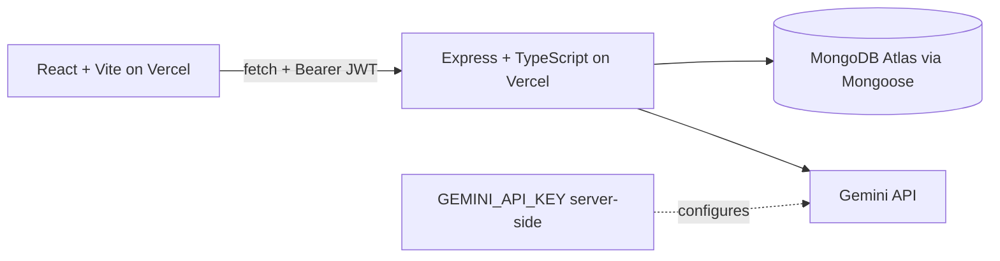

[](https://github.com/jhenellealonzo/itelect4-backend/actions/workflows/ci.yml)

# Campus Lost & Found Tracker Backend

This Express/TypeScript API powers the Campus Lost & Found Tracker. It provides MongoDB/Mongoose persistence, JWT authentication, item and claim workflows, and a protected Gemini-powered AI Report Review endpoint.

## API capabilities

- **Items routes** — browse and manage lost and found item records.
- **Claims routes** — create and review proof-backed claims for items.
- **Authentication** — register and log in users; successful login returns a Bearer JWT.
- **AI Report Review** — `POST /api/ai` is protected by JWT authentication, limited to five reviews per user per minute, and validated with Zod before the server calls Gemini.

The AI route returns the structured fields `summary`, `keyDetails`, `suggestions`, and `readiness`.

### Route summary

| Route | Purpose | Access |
| --- | --- | --- |
| `POST /api/auth/register` | Register a user | Public |
| `POST /api/auth/login` | Authenticate and issue a JWT | Public |
| `GET /api/items` and `GET /api/items/:id` | Browse item records | Public |
| `POST /api/items`, `PATCH/DELETE /api/items/:id` | Create, update, or delete an owned item | Protected |
| `GET/POST /api/claims` | Read or submit claims | Protected |
| `POST /api/ai` | Review a lost-or-found report | Protected |
| `GET /api/health` | Check API and database status | Public |

## Architecture



## Environment variables

Copy `.env.example` to `.env` for local development and fill in values locally. Never commit `.env` or secret values.

| Variable | Purpose |
| --- | --- |
| `MONGODB_URI` | MongoDB Atlas connection string |
| `JWT_SECRET` | Secret used to sign and verify login tokens |
| `CORS_ORIGIN` | Allowed frontend origin(s), comma-separated if needed |
| `GEMINI_API_KEY` | Server-side Gemini credential for AI Report Review |
| `PORT` | Local HTTP port; defaults to `4000` |

For local development, use `CORS_ORIGIN=http://localhost:5173` and `PORT=4000`. Production `CORS_ORIGIN` must be the exact frontend origin without a trailing slash.

## Local development

Requirements: Node.js 24 (Node.js 22.12 or newer is also supported by the project requirements) and npm.

```bash
npm install
copy .env.example .env
npm run dev
```

The API runs at `http://localhost:4000` by default. The backend also exposes `GET /api/health`.

## Verification commands

```bash
npm run typecheck
npm test
npm run build
```

The Supertest suite exercises the real Express app and the protected `POST /api/ai` route. It mocks only the database connection, so the authentication and Zod validation middleware remain real while tests do not contact MongoDB Atlas or Gemini.

`npm run try-ai` is also available when the local environment is configured for a real Gemini request.

## Deployment and related repository

The verified current deployments are:

- Backend: [itelect4-backend-theta.vercel.app](https://itelect4-backend-theta.vercel.app)
- Health endpoint: [itelect4-backend-theta.vercel.app/api/health](https://itelect4-backend-theta.vercel.app/api/health), currently returning `{"ok":true,"db":true}`
- Frontend: [itelect4-project-cyan.vercel.app](https://itelect4-project-cyan.vercel.app)
- Frontend repository: [jhenellealonzo/itelect4-project](https://github.com/jhenellealonzo/itelect4-project)

## AI-use disclosure

AI tools were used as development assistants for selected code review, testing/CI guidance, and documentation tasks. The final implementation remains subject to the student's own review, testing, and explanation.
